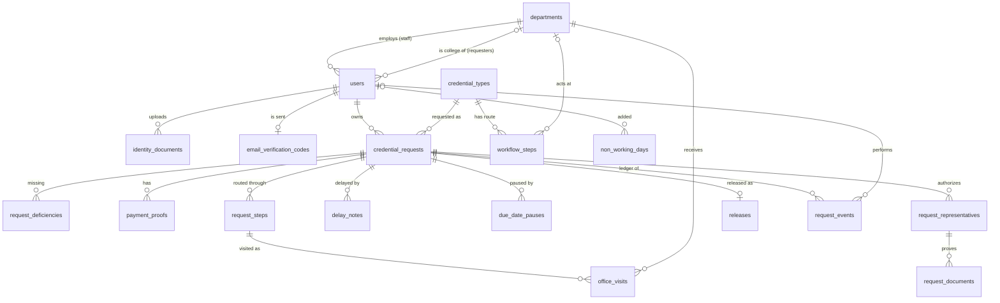

# Data Dictionary

Databases: **MySQL 8.0** (server and CI; 8.4 works locally), one per environment with the same schema: `uphsl_credential_tracker`
(production), `uphsl_credential_tracker_staging` (staging), `uphsl_credential_tracker_local`
(local) and `uphsl_credential_tracker_testing` (automated tests). Charset `utf8mb4`, collation `utf8mb4_unicode_ci`. Times are stored in
the app timezone **Asia/Manila**. Every table has an auto-increment `id` primary key
(`bigint unsigned`) unless stated. `created_at` / `updated_at` are Laravel timestamps.

**Key:** PK primary key · FK foreign key · UQ unique · IX indexed · Null = column may be empty.

## Entity relationships

- A **requester** owns **credential requests**, uploads **identity documents**; a **department staff** user belongs to one **office**.
- A **credential type** has an ordered **route** (`workflow_steps`) of offices with tasks.
- On acceptance the route is copied into **request_steps** (plus the Registrar's final check);
  each physical stay at an office is an **office_visit**.
- Deficiencies, payment proofs, delay notes, pauses, representatives (with their documents), the
  release record and the **request_events** ledger all belong to a request.

Nothing that belongs to a request can be deleted: all request foreign keys are `RESTRICT`.

---

## users

Accounts for all three roles.

| Column | Type | Null | Key | Default | Description |
|---|---|---|---|---|---|
| id | bigint unsigned | No | PK | | |
| first_name | varchar(100) | Yes | | | Requesters give it in My Profile after signing up |
| middle_name | varchar(100) | Yes | | | Shown as an initial: "Juan S. Dela Cruz" |
| last_name | varchar(100) | Yes | | | Requesters give it in My Profile after signing up |
| email | varchar(255) | No | UQ | | Login name |
| google_id | varchar(64) | Yes | UQ | | Google account ID once the user signs in with Google (REQ-01-24) |
| contact_number | varchar(20) | Yes | | | Requesters: 11 digits, given in My Profile |
| privacy_consented_at | timestamp | Yes | | | When the requester agreed to the Data Privacy Act notice (first My Profile save) |
| role | varchar(20) | No | IX | `student` | `student`, `registrar`, `department` (see [Role](#role)) |
| department_id | bigint unsigned | Yes | FK → departments | | Only for `department` staff |
| academic_status | varchar(20) | Yes | | | Requesters: `current`, `graduate`, `former` (see [AcademicStatus](#academicstatus)) |
| college_id | bigint unsigned | Yes | FK → departments | | Requesters: their college (the Dean on routes) |
| program | varchar(150) | Yes | | | Requesters: program or strand |
| student_number | varchar(30) | Yes | | | Requesters: optional |
| attended_from, attended_to | smallint unsigned | Yes | | | Requesters: years attended |
| identity_status | varchar(20) | No | IX | `unsubmitted` | See [IdentityStatus](#identitystatus); set by uploads and the registrar's review only |
| identity_verified_at | timestamp | Yes | | | When the registrar verified the requester's ID |
| is_active | tinyint(1) | No | | 1 | 0 = deactivated by the registrar; cannot log in |
| email_verified_at | timestamp | Yes | | | Required before a student can submit a request |
| password | varchar(255) | Yes | | | Bcrypt hash; empty for accounts made through Google |
| remember_token | varchar(100) | Yes | | | "Remember me" token |
| created_at, updated_at | timestamp | Yes | | | |

## departments

Offices on credential routes (spec 02): the colleges (as the Dean), Registrar, VP Finance, Chancellor and President. Never deleted, only deactivated.

| Column | Type | Null | Key | Default | Description |
|---|---|---|---|---|---|
| id | bigint unsigned | No | PK | | |
| name | varchar(150) | No | UQ | | e.g. "College of Computer Studies" |
| code | varchar(20) | No | UQ | | Upper-case short code, e.g. `CCS`, `VPF`; `REG` = Office of the Registrar |
| type | varchar(20) | No | IX | | `college` or `office` (see [DepartmentType](#departmenttype)) |
| description | varchar(255) | Yes | | | Role in the route, e.g. "Documentary stamp (no signature)" |
| is_active | tinyint(1) | No | IX | 1 | Inactive departments cannot be chosen for new requests or workflow steps |
| created_at, updated_at | timestamp | Yes | | | |

## credential_types

The credential master list (spec 03): documents requesters can ask for. Never deleted, only deactivated.

| Column | Type | Null | Key | Default | Description |
|---|---|---|---|---|---|
| id | bigint unsigned | No | PK | | |
| name | varchar(150) | No | UQ | | e.g. "Transcript of Records (TOR)" |
| description | text | Yes | | | Shown to requesters on the request form |
| requires_payment | tinyint(1) | No | | 0 | 1 = student must pay on the UPHSL portal and upload a receipt |
| fee | decimal(10,2) | Yes | | | Fee per copy in pesos; only kept when payment is required |
| processing_days | tinyint unsigned | No | | 5 | Processing period in working days (spec 10), used for the due date |
| requirements | json | Yes | | | List of documentary requirements, shown before submitting and checked by the evaluator |
| special_conditions | text | Yes | | | Shown before submitting |
| requires_receiving_institution | tinyint(1) | No | | 0 | 1 = transfer credential: the receiving school's complete name is required |
| is_active | tinyint(1) | No | IX | 1 | Inactive types cannot be requested |
| created_at, updated_at | timestamp | Yes | | | |

## workflow_steps

The route (template) of a credential type: its offices in order and each one's task, edited by the registrar.

| Column | Type | Null | Key | Default | Description |
|---|---|---|---|---|---|
| id | bigint unsigned | No | PK | | |
| credential_type_id | bigint unsigned | No | FK → credential_types (cascade), IX | | |
| position | smallint unsigned | No | IX (with credential_type_id) | | 1, 2, 3 … with no gaps |
| department_id | bigint unsigned | Yes | FK → departments | | Empty when `is_student_college` = 1 |
| is_student_college | tinyint(1) | No | | 0 | 1 = Dean placeholder, replaced by the request's college when routed |
| task | varchar(20) | No | | sign | `prepare`, `sign` or `documentary_stamp` (see [RouteTask](#routetask)) |
| instructions | varchar(255) | Yes | | | Note for the signing office |
| created_at, updated_at | timestamp | Yes | | | |

Rules: at most one Dean step per route; an office appears at most once.

## credential_requests

One row per request (specs 04, 05, 11). Status changes only through `RequestWorkflow`.

| Column | Type | Null | Key | Default | Description |
|---|---|---|---|---|---|
| id | bigint unsigned | No | PK | | |
| reference_no | varchar(20) | Yes | UQ | | Tracking number `CR-YYYY-NNNNNN` (set right after insert) |
| user_id | bigint unsigned | No | FK → users, IX (with created_at) | | The document owner (requester) |
| credential_type_id | bigint unsigned | No | FK → credential_types | | |
| copies | tinyint unsigned | No | | 1 | 1–10 |
| purpose | varchar(500) | No | | | |
| receiving_institution | varchar(255) | Yes | | | Receiving school (required for transfer credentials) |
| college_id | bigint unsigned | No | FK → departments | | Snapshot of the requester's college; resolves the Dean step |
| academic_status | varchar(20) | No | | | Snapshot (see [AcademicStatus](#academicstatus)) |
| program | varchar(150) | No | | | Snapshot: program or strand |
| student_number | varchar(30) | Yes | | | Snapshot |
| attended_from, attended_to | smallint unsigned | No | | | Snapshot: years attended |
| requester_mode | varchar(20) | No | | personal | `personal` or `representative` (see [RequesterMode](#requestermode)) |
| requires_payment | tinyint(1) | No | | 0 | Snapshot of the credential type |
| fee | decimal(10,2) | Yes | | | Snapshot: fee per copy |
| amount_due | decimal(10,2) | Yes | | | fee × copies |
| status | varchar(30) | No | IX | | See [RequestStatus](#requeststatus) |
| submitted_at | timestamp | Yes | IX (with status) | | |
| evaluation_started_at | timestamp | Yes | | | When an evaluator took it up |
| evaluated_by | bigint unsigned | Yes | FK → users, IX | | The evaluator (evaluator performance report) |
| requirements_completed_at | timestamp | Yes | | | |
| declined_at, decline_reason | timestamp, varchar(500) | Yes | | | Not eligible |
| accepted_at | timestamp | Yes | IX | | Processing clock starts |
| accepted_by | bigint unsigned | Yes | FK → users | | |
| due_at | timestamp | Yes | | | End of the last working day of the processing period; never changed |
| adjusted_due_at | timestamp | Yes | | | `due_at` moved by closed due-date pauses |
| effective_due_at | timestamp | Yes | IX (with status) | | Stored generated column: `COALESCE(adjusted_due_at, due_at)`; overdue = being processed and past it |
| ready_at | timestamp | Yes | | | Final quality check done |
| released_at | timestamp | Yes | IX | | |
| processing_working_days | smallint unsigned | Yes | | | Working days from acceptance to release, frozen at release |
| cancelled_at, cancel_reason | timestamp, varchar(500) | Yes | | | |
| created_at, updated_at | timestamp | Yes | | | |

## request_deficiencies

Missing requirements found during evaluation (spec 04).

| Column | Type | Null | Key | Default | Description |
|---|---|---|---|---|---|
| id | bigint unsigned | No | PK | | |
| credential_request_id | bigint unsigned | No | FK → credential_requests | | |
| description | varchar(255) | No | | | e.g. "PSA-authenticated birth certificate" |
| recorded_by | bigint unsigned | No | FK → users | | Evaluator |
| resolved_at | timestamp | Yes | | | When compliance was recorded |
| resolved_by | bigint unsigned | Yes | FK → users | | Staff member who verified it |
| resolution | varchar(500) | Yes | | | What was received / clearance status |
| created_at, updated_at | timestamp | Yes | | | |

## request_steps

A request's route, copied from its credential type at acceptance, with the Registrar's final
quality check appended (spec 05).

| Column | Type | Null | Key | Default | Description |
|---|---|---|---|---|---|
| id | bigint unsigned | No | PK | | |
| credential_request_id | bigint unsigned | No | FK → credential_requests, UQ (with position) | | |
| position | smallint unsigned | No | | | 1, 2, 3 … |
| department_id | bigint unsigned | No | FK → departments | | The office (Dean step already resolved) |
| task | varchar(20) | No | | | See [RouteTask](#routetask) |
| instructions | varchar(255) | Yes | | | Copied from the route template |
| status | varchar(20) | No | | | See [StepStatus](#stepstatus) |
| completed_at | timestamp | Yes | | | |
| created_at, updated_at | timestamp | Yes | | | |

## office_visits

One row per physical stay of the document at an office; a return and re-send create new rows
and earlier rows are never overwritten (spec 05).

| Column | Type | Null | Key | Default | Description |
|---|---|---|---|---|---|
| id | bigint unsigned | No | PK | | |
| credential_request_id | bigint unsigned | No | FK → credential_requests, IX (with id) | | |
| request_step_id | bigint unsigned | No | FK → request_steps | | The route step the visit serves |
| department_id | bigint unsigned | No | FK → departments, IX (with status), IX (with completed_at) | | The office |
| visit_no | smallint unsigned | No | | | 1, 2 … per request and office |
| purpose | varchar(20) | No | | | See [VisitPurpose](#visitpurpose) |
| status | varchar(20) | No | | | See [VisitStatus](#visitstatus) |
| from_department_id | bigint unsigned | Yes | FK → departments | | Office it came from |
| forwarded_at, forwarded_by | timestamp, bigint unsigned | No | FK → users | | Dispatch |
| received_at, received_by | timestamp, bigint unsigned | Yes | FK → users | | Accept receipt |
| completed_at, completed_by | timestamp, bigint unsigned | Yes | FK → users | | Approved, returned or bypassed |
| returned_to_department_id | bigint unsigned | Yes | FK → departments | | Where it was returned for correction |
| return_reason, corrective_action, remarks | varchar(500) | Yes | | | |
| working_days | smallint unsigned | Yes | | | Working days from receipt to completion, frozen when the visit closes |
| created_at, updated_at | timestamp | Yes | | | |

## delay_notes

Recorded reasons for delays (spec 05). Append-only.

| Column | Type | Null | Key | Default | Description |
|---|---|---|---|---|---|
| id | bigint unsigned | No | PK | | |
| credential_request_id | bigint unsigned | No | FK → credential_requests | | |
| office_visit_id | bigint unsigned | Yes | FK → office_visits | | The visit holding the document then |
| department_id | bigint unsigned | Yes | FK → departments | | The office holding it (not necessarily the cause) |
| category | varchar(30) | No | IX | | See [DelayCategory](#delaycategory) |
| reason, corrective_action | varchar(500) | No / Yes | | | |
| recorded_by | bigint unsigned | No | FK → users | | |
| created_at | timestamp | No | | CURRENT_TIMESTAMP | |

## due_date_pauses

Approved pauses of the processing period while the customer acts (spec 05).

| Column | Type | Null | Key | Default | Description |
|---|---|---|---|---|---|
| id | bigint unsigned | No | PK | | |
| credential_request_id | bigint unsigned | No | FK → credential_requests | | |
| reason | varchar(500) | No | | | Message to the customer |
| resume_status | varchar(30) | No | | | Status to return to |
| started_at, started_by | timestamp, bigint unsigned | No | FK → users | | |
| ended_at, ended_by | timestamp, bigint unsigned | Yes | FK → users | | |
| working_days | smallint unsigned | Yes | | | Working days paused; added to the adjusted due date |
| created_at, updated_at | timestamp | Yes | | | |

## payment_proofs

Proofs of payment uploaded by the requester (private files on the receipts disk).

| Column | Type | Null | Key | Default | Description |
|---|---|---|---|---|---|
| id | bigint unsigned | No | PK | | |
| credential_request_id | bigint unsigned | No | FK → credential_requests | | |
| uploaded_by | bigint unsigned | No | FK → users | | |
| path, original_name, mime_type, size | | No | | | File on the private disk |
| reference_no | varchar(100) | Yes | | | Payment reference given by the requester |
| amount | decimal(10,2) | Yes | | | Amount paid, as given |
| paid_on | date | Yes | | | Date paid, as given |
| status | varchar(20) | No | IX | | See [PaymentStatus](#paymentstatus) |
| official_receipt_no | varchar(50) | Yes | | | Recorded by the registrar on verification |
| reviewed_by, reviewed_at, remarks | | Yes | | | |
| created_at, updated_at | timestamp | Yes | | | |

## request_representatives

Authorized representatives, recorded apart from the owner's account (spec 11).

| Column | Type | Null | Key | Default | Description |
|---|---|---|---|---|---|
| id | bigint unsigned | No | PK | | |
| credential_request_id | bigint unsigned | No | FK → credential_requests | | |
| full_name | varchar(150) | No | | | |
| relationship | varchar(100) | Yes | | | |
| contact_number | varchar(20) | Yes | | | |
| status | varchar(20) | No | | | See [ReviewStatus](#reviewstatus) |
| declared_by | bigint unsigned | No | FK → users | | Owner or registrar |
| reviewed_by, reviewed_at, remarks | | Yes | | | Verification of the SPA and IDs |
| created_at, updated_at | timestamp | Yes | | | |

## request_documents

A representative's SPA and valid ID (private files under `request-documents/{request}/`).

| Column | Type | Null | Key | Default | Description |
|---|---|---|---|---|---|
| id | bigint unsigned | No | PK | | |
| credential_request_id | bigint unsigned | No | FK → credential_requests | | |
| request_representative_id | bigint unsigned | Yes | FK → request_representatives | | |
| kind | varchar(30) | No | | | See [DocumentKind](#documentkind) |
| path, original_name, mime_type, size | | No | | | |
| uploaded_by | bigint unsigned | No | FK → users | | |
| created_at, updated_at | timestamp | Yes | | | |

## releases

The release acknowledgment, one per released request (spec 11).

| Column | Type | Null | Key | Default | Description |
|---|---|---|---|---|---|
| id | bigint unsigned | No | PK | | |
| credential_request_id | bigint unsigned | No | FK → credential_requests, UQ | | |
| recipient_type | varchar(20) | No | | | See [RecipientType](#recipienttype) |
| request_representative_id | bigint unsigned | Yes | FK → request_representatives | | Verified representative who claimed it |
| recipient_name | varchar(150) | No | | | |
| id_presented | varchar(100) | No | | | |
| acknowledged | tinyint(1) | No | | | Recipient acknowledged receipt |
| released_by | bigint unsigned | No | FK → users | | |
| released_at | timestamp | No | | | |
| remarks | varchar(500) | Yes | | | |
| created_at, updated_at | timestamp | Yes | | | |

## request_events

The append-only ledger: every action on a request. Rows are never updated or deleted.

| Column | Type | Null | Key | Default | Description |
|---|---|---|---|---|---|
| id | bigint unsigned | No | PK | | |
| credential_request_id | bigint unsigned | No | FK → credential_requests, IX (with id) | | |
| actor_id | bigint unsigned | Yes | FK → users | | Who did it |
| type | varchar(40) | No | IX (with created_at) | | See [RequestEventType](#requesteventtype) |
| from_status, to_status | varchar(30) | Yes | | | Set when the request status changed |
| request_step_id | bigint unsigned | Yes | FK → request_steps | | |
| office_visit_id | bigint unsigned | Yes | FK → office_visits | | |
| department_id | bigint unsigned | Yes | FK → departments | | Office involved |
| remarks | text | Yes | | | |
| created_at | timestamp | No | | CURRENT_TIMESTAMP | |

## reminder_logs

Due-date reminders already sent (spec 06), so a rerun never sends them twice.

| Column | Type | Null | Key | Default | Description |
|---|---|---|---|---|---|
| id | bigint unsigned | No | PK | | |
| kind | varchar(30) | No | UQ (with subject_id) | | `office_due_soon`, `office_overdue` or `requester_overdue` |
| subject_id | bigint unsigned | No | | | Office visit id for office reminders, request id for the requester's notice |
| credential_request_id | bigint unsigned | No | FK → credential_requests | | |
| created_at | timestamp | No | | CURRENT_TIMESTAMP | |

## notifications

Laravel database notifications (the bell). `id` is a UUID.

| Column | Type | Null | Key | Description |
|---|---|---|---|---|
| id | char(36) | No | PK | UUID |
| type | varchar(255) | No | | `App\Notifications\RequestActivity` |
| notifiable_type, notifiable_id | varchar(255), bigint unsigned | No | IX | The recipient user |
| data | text | No | | JSON: `request_id`, `reference_no`, `event_type`, `title`, `message`, `url` |
| read_at | timestamp | Yes | | Empty = unread |
| created_at, updated_at | timestamp | Yes | | |

## identity_documents

Requesters' uploaded valid IDs (spec 01). Files live privately on the receipts disk under
`identity-documents/{user_id}/`; only the owner and registrars can open them. Every upload is kept.

| Column | Type | Null | Key | Default | Description |
|---|---|---|---|---|---|
| id | bigint unsigned | No | PK | | |
| user_id | bigint unsigned | No | FK → users | | The requester |
| id_type | varchar(60) | No | | | e.g. "Passport", "PhilSys National ID" |
| path | varchar(255) | No | | | Path on the private disk |
| original_name | varchar(255) | No | | | File name as uploaded |
| mime_type | varchar(100) | No | | | |
| size | int unsigned | No | | | Bytes |
| status | varchar(20) | No | IX | | `pending`, `verified`, `rejected` (see [ReviewStatus](#reviewstatus)) |
| reviewed_by | bigint unsigned | Yes | FK → users | | Registrar who reviewed it |
| reviewed_at | timestamp | Yes | | | |
| remarks | varchar(500) | Yes | | | Reason for a rejection, shown to the requester |
| created_at, updated_at | timestamp | Yes | | | |

## email_verification_codes

The one-time code that confirms a user's email address (REQ-01-23). One row per user; a new code
replaces the old one and a successful check deletes it.

| Column | Type | Null | Key | Default | Description |
|---|---|---|---|---|---|
| id | bigint unsigned | No | PK | | |
| user_id | bigint unsigned | No | FK → users, UQ | | Cascade on delete |
| code_hash | varchar(255) | No | | | Bcrypt hash of the 6-digit code; the code itself is never stored |
| expires_at | timestamp | No | | | 10 minutes after sending |
| attempts | tinyint unsigned | No | | 0 | Wrong tries; the code stops working at 5 |
| created_at, updated_at | timestamp | Yes | | | |

## non_working_days

The working calendar (spec 10): holidays and closures that due dates and time per office skip.
Working days are the `uphsl.work_week` days (Monday–Saturday) not listed here.

| Column | Type | Null | Key | Default | Description |
|---|---|---|---|---|---|
| id | bigint unsigned | No | PK | | |
| date | date | No | UQ | | The non-working day |
| name | varchar(150) | No | | | e.g. "Rizal Day", "Typhoon closure" |
| kind | varchar(20) | No | | | `holiday`, `special` or `closure` (see [NonWorkingDayKind](#nonworkingdaykind)) |
| created_by | bigint unsigned | Yes | FK → users | | Registrar who added it; empty for seeded holidays |
| created_at, updated_at | timestamp | Yes | | | |

## Framework tables

These belong to Laravel and are not part of the domain model.

| Table | Purpose |
|---|---|
| password_reset_tokens | "Forgot password" tokens (email PK, token, created_at) |
| sessions | Logged-in sessions (database session driver) |
| cache, cache_locks | Database cache store |
| jobs, job_batches, failed_jobs | Queue (notifications and emails are queued) |
| migrations | Applied migrations |

---

## Code values (enums)

Stored as strings; defined in `app/Enums`.

### Role
| Value | Label |
|---|---|
| `student` | Student |
| `registrar` | Registrar |
| `department` | Department Staff |

### DepartmentType
| Value | Label |
|---|---|
| `college` | College (academic verification and Dean's approval) |
| `office` | Office (Library, Cashier, Student Affairs, Registrar, …) |

### RequestStatus

| Value | Meaning |
|---|---|
| `submitted` | Online request received |
| `under_evaluation` | Records and requirements being reviewed |
| `pending_compliance` | Requester must submit missing documents or complete clearance |
| `returned_for_customer_action` | Requester must clarify or act (pauses the clock after acceptance) |
| `awaiting_payment` | Requirements complete; payment instructions given |
| `payment_verification` | Proof of payment awaiting verification |
| `accepted_for_processing` | Accepted; processing period started |
| `in_progress` | With the processing offices |
| `returned_for_correction` | Returned by an office to an earlier office (requesters see "In progress") |
| `for_final_approval` | At the Registrar for the final quality check |
| `ready_for_release` | Available for claiming |
| `released` | Released to the owner or an authorized representative |
| `declined` | Not eligible |
| `cancelled` | Cancelled |

### StepStatus

| Value | Meaning |
|---|---|
| `waiting` | Not reached yet |
| `current` | The step being worked on |
| `completed` | Done |
| `bypassed` | Passed over by the registrar, with a reason |

### VisitStatus

| Value | Meaning |
|---|---|
| `in_transit` | Forwarded, not yet received |
| `received` | In the office |
| `completed` | Approved and released to the next office |
| `returned` | Returned to an earlier office for correction |
| `bypassed` | Closed by a registrar bypass or cancellation |

### VisitPurpose

| Value | Meaning |
|---|---|
| `route` | The office's own step |
| `correction` | Returned to this office to be corrected |
| `resubmission` | Corrected and sent back to the office that returned it |

### PaymentStatus

| Value | Meaning |
|---|---|
| `submitted` | For verification |
| `verified` | Verified against the official record |
| `rejected` | Rejected, with remarks |

### RequestEventType

Submission and evaluation: `submitted`, `evaluation_started`, `compliance_requested`,
`deficiency_resolved`, `customer_action_requested`, `customer_responded`, `requirements_completed`,
`declined`, `college_changed`. Payment and acceptance: `payment_submitted`, `payment_rejected`,
`payment_verified`, `accepted`. Routing: `document_forwarded`, `receipt_accepted`,
`step_completed`, `document_returned`, `document_resubmitted`, `delay_recorded`, `step_bypassed`,
`ready_for_release`. Representatives and release: `representative_declared`,
`representative_verified`, `representative_rejected`, `released`. And `cancelled`. Internal
entries hidden from requesters: forwarding, returns, resubmissions, delay notes, bypasses.

### DelayCategory

`registrar_evaluation`, `customer_compliance`, `payment_verification`, `academic_department`,
`documentary_stamp`, `pending_signature`, `document_correction`, `system_issue`, `other` (the
client's delay categories, *Proposed Workflow* IX-D).

### RequesterMode

`personal`, `representative`.

### DocumentKind

`spa` (Special Power of Attorney), `representative_id`.

### RecipientType

`owner`, `representative`.

### NonWorkingDayKind

| Value | Meaning |
|---|---|
| `holiday` | Regular holiday |
| `special` | Special non-working day |
| `closure` | Office closure (e.g. typhoon, university event) |

### RouteTask

| Value | Meaning |
|---|---|
| `prepare` | Verify records and prepare the credential (the Registrar) |
| `sign` | Review and affix a signature (Dean, Chancellor, President) |
| `documentary_stamp` | Process the documentary stamp; no signature (VP Finance) |
| `final_check` | The Registrar's final quality check, appended to every request's route |

### AcademicStatus

| Value | Meaning |
|---|---|
| `current` | Current student |
| `graduate` | Graduate |
| `former` | Former student (did not graduate) |

### IdentityStatus

| Value | Meaning |
|---|---|
| `unsubmitted` | No valid ID uploaded yet |
| `pending` | ID uploaded, awaiting the registrar |
| `verified` | The registrar verified the ID |
| `rejected` | The registrar rejected the latest ID; the requester may upload another |

### ReviewStatus

| Value | Meaning |
|---|---|
| `pending` | Uploaded, for verification |
| `verified` | Verified by the registrar |
| `rejected` | Rejected, with a reason |
