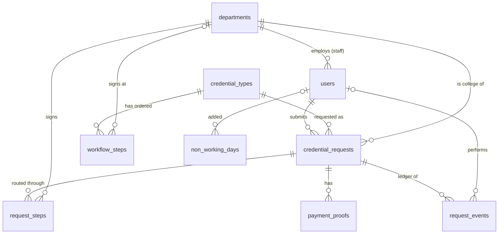

# Data Dictionary

Databases: **MySQL 8.0** (server and CI; 8.4 works locally), one per environment with the same schema: `uphsl_credential_tracker`
(production), `uphsl_credential_tracker_staging` (staging), `uphsl_credential_tracker_local`
(local) and `uphsl_credential_tracker_testing` (automated tests). Charset `utf8mb4`, collation `utf8mb4_unicode_ci`. Times are stored in
the app timezone **Asia/Manila**. Every table has an auto-increment `id` primary key
(`bigint unsigned`) unless stated. `created_at` / `updated_at` are Laravel timestamps.

**Key:** PK primary key · FK foreign key · UQ unique · IX indexed · Null = column may be empty.

## Entity relationships

- A **user** (student) has many **credential requests**; a **department staff** user belongs to one **department**.
- A **credential type** has an ordered **workflow** (`workflow_steps`) of departments.
- When a request is routed, the workflow is copied into **request_steps** (one per signing office).
- **payment_proofs** and **request_events** (the ledger) belong to a request.

Nothing that belongs to a request can be deleted: all request foreign keys are `RESTRICT`.

---

## users

Accounts for all three roles.

| Column | Type | Null | Key | Default | Description |
|---|---|---|---|---|---|
| id | bigint unsigned | No | PK | | |
| first_name | varchar(100) | No | | | |
| middle_name | varchar(100) | Yes | | | Shown as an initial: "Juan S. Dela Cruz" |
| last_name | varchar(100) | No | | | |
| email | varchar(255) | No | UQ | | Login name |
| role | varchar(20) | No | IX | `student` | `student`, `registrar`, `department` (see [Role](#role)) |
| department_id | bigint unsigned | Yes | FK → departments | | Only for `department` staff |
| is_active | tinyint(1) | No | | 1 | 0 = deactivated by the registrar; cannot log in |
| email_verified_at | timestamp | Yes | | | Required before a student can submit a request |
| password | varchar(255) | No | | | Bcrypt hash |
| remember_token | varchar(100) | Yes | | | "Remember me" token |
| created_at, updated_at | timestamp | Yes | | | |

## departments

Offices on credential routes (spec 02): the colleges (as the Dean), Registrar, VP Finance, Chancellor and President. Never deleted, only deactivated.

| Column | Type | Null | Key | Default | Description |
|---|---|---|---|---|---|
| id | bigint unsigned | No | PK | | |
| name | varchar(150) | No | UQ | | e.g. "College of Computer Studies" |
| code | varchar(20) | No | UQ | | Upper-case short code, e.g. `CCS`, `VPF`; `REG` = Office of the Registrar |
| type | varchar(20) | No | IX | | `college` or `office` (see [DepartmentType](#departmenttype)) |
| description | varchar(255) | Yes | | | Role in the route, e.g. "Documentary stamp (no signature)" |
| is_active | tinyint(1) | No | IX | 1 | Inactive departments cannot be chosen for new requests or workflow steps |
| created_at, updated_at | timestamp | Yes | | | |

## credential_types

The credential master list (spec 03): documents requesters can ask for. Never deleted, only deactivated.

| Column | Type | Null | Key | Default | Description |
|---|---|---|---|---|---|
| id | bigint unsigned | No | PK | | |
| name | varchar(150) | No | UQ | | e.g. "Transcript of Records (TOR)" |
| description | text | Yes | | | Shown to requesters on the request form |
| requires_payment | tinyint(1) | No | | 0 | 1 = student must pay on the UPHSL portal and upload a receipt |
| fee | decimal(10,2) | Yes | | | Fee per copy in pesos; only kept when payment is required |
| processing_days | tinyint unsigned | No | | 5 | Processing period in working days (spec 10), used for the due date |
| requirements | json | Yes | | | List of documentary requirements, shown before submitting and checked by the evaluator |
| special_conditions | text | Yes | | | Shown before submitting |
| requires_receiving_institution | tinyint(1) | No | | 0 | 1 = transfer credential: the receiving school's complete name is required |
| is_active | tinyint(1) | No | IX | 1 | Inactive types cannot be requested |
| created_at, updated_at | timestamp | Yes | | | |

## workflow_steps

The route (template) of a credential type: its offices in order and each one's task, edited by the registrar.

| Column | Type | Null | Key | Default | Description |
|---|---|---|---|---|---|
| id | bigint unsigned | No | PK | | |
| credential_type_id | bigint unsigned | No | FK → credential_types (cascade), IX | | |
| position | smallint unsigned | No | IX (with credential_type_id) | | 1, 2, 3 … with no gaps |
| department_id | bigint unsigned | Yes | FK → departments | | Empty when `is_student_college` = 1 |
| is_student_college | tinyint(1) | No | | 0 | 1 = Dean placeholder, replaced by the request's college when routed |
| task | varchar(20) | No | | sign | `prepare`, `sign` or `documentary_stamp` (see [RouteTask](#routetask)) |
| instructions | varchar(255) | Yes | | | Note for the signing office |
| created_at, updated_at | timestamp | Yes | | | |

Rules: at most one Dean step per route; an office appears at most once.

## credential_requests

A student's request for a credential.

| Column | Type | Null | Key | Default | Description |
|---|---|---|---|---|---|
| id | bigint unsigned | No | PK | | |
| reference_no | varchar(20) | Yes | UQ | | `CR-<year>-<6-digit id>`, e.g. `CR-2026-000042`; set right after insert; used in URLs |
| user_id | bigint unsigned | No | FK → users, IX | | The requesting student |
| credential_type_id | bigint unsigned | No | FK → credential_types | | |
| college_id | bigint unsigned | No | FK → departments | | The student's college (decides which Dean signs) |
| student_number | varchar(30) | No | | | Letters, digits and dashes |
| program | varchar(150) | No | | | e.g. "BS Computer Science" |
| student_status | varchar(10) | No | | | `current` or `alumni` (see [StudentStatus](#studentstatus)) |
| last_school_year | varchar(9) | No | | | `YYYY-YYYY`, consecutive years |
| purpose | varchar(500) | No | | | e.g. "Employment" |
| copies | tinyint unsigned | No | | 1 | 1–10 |
| requires_payment | tinyint(1) | No | | | Copy of the credential type's setting at submission |
| fee | decimal(10,2) | Yes | | | Copy of the fee at submission |
| status | varchar(30) | No | IX | | See [RequestStatus](#requeststatus) |
| routed_at | timestamp | Yes | | | When the registrar approved and routed it |
| due_at | timestamp | Yes | IX (with status) | | End of the working day `processing_days` working days after `routed_at` (spec 10); past due while in progress = overdue |
| ready_at | timestamp | Yes | | | When the last office signed |
| released_at | timestamp | Yes | | | When the student claimed it |
| cancelled_at | timestamp | Yes | | | |
| cancel_reason | varchar(500) | Yes | | | |
| created_at | timestamp | Yes | IX | | Submission time |
| updated_at | timestamp | Yes | | | |

Indexes: `(status, created_at)`, `(status, due_at)`, `(user_id, created_at)`.

## request_steps

The request's own copy of the workflow: one row per office that must sign.

| Column | Type | Null | Key | Default | Description |
|---|---|---|---|---|---|
| id | bigint unsigned | No | PK | | |
| credential_request_id | bigint unsigned | No | FK → credential_requests, IX | | |
| position | smallint unsigned | No | IX (with request) | | Signing order |
| department_id | bigint unsigned | No | FK → departments, IX (with status) | | The actual office (Student's College already resolved) |
| instructions | varchar(255) | Yes | | | Copied from the workflow step |
| status | varchar(20) | No | IX (with department) | | See [StepStatus](#stepstatus) |
| acted_by | bigint unsigned | Yes | FK → users | | Who signed / held / skipped (not shown to students) |
| acted_at | timestamp | Yes | | | |
| remarks | varchar(500) | Yes | | | Signing remarks, hold reason or skip reason |
| created_at, updated_at | timestamp | Yes | | | `updated_at` = when it became the current step |

Only one step per request is `pending` or `on_hold` at a time (sequential flow).

## payment_proofs

Receipts uploaded by students for paid credentials. Earlier (rejected) uploads are kept.

| Column | Type | Null | Key | Default | Description |
|---|---|---|---|---|---|
| id | bigint unsigned | No | PK | | |
| credential_request_id | bigint unsigned | No | FK → credential_requests | | |
| uploaded_by | bigint unsigned | No | FK → users | | The student |
| path | varchar(255) | No | | | Private storage path `payment-proofs/{request id}/{uuid}.{ext}` |
| original_name | varchar(255) | No | | | File name as uploaded |
| mime_type | varchar(100) | No | | | `image/jpeg`, `image/png`, `image/webp` or `application/pdf` |
| size | int unsigned | No | | | Bytes (max 5 MB) |
| reference_no | varchar(100) | Yes | | | Payment reference entered by the student |
| amount | decimal(10,2) | Yes | | | Amount paid, entered by the student |
| status | varchar(20) | No | IX | | See [PaymentStatus](#paymentstatus) |
| reviewed_by | bigint unsigned | Yes | FK → users | | Registrar who accepted/rejected |
| reviewed_at | timestamp | Yes | | | |
| remarks | varchar(500) | Yes | | | Rejection reason |
| created_at, updated_at | timestamp | Yes | | | |

## request_events

The **ledger**: an append-only history of everything that happened to a request. The
application refuses to update or delete these rows.

| Column | Type | Null | Key | Default | Description |
|---|---|---|---|---|---|
| id | bigint unsigned | No | PK | | Also the order of events |
| credential_request_id | bigint unsigned | No | FK → credential_requests, IX (with id) | | |
| actor_id | bigint unsigned | Yes | FK → users | | Who did it |
| type | varchar(30) | No | | | See [RequestEventType](#requesteventtype) |
| from_status | varchar(30) | Yes | | | Request status before (empty if unchanged) |
| to_status | varchar(30) | Yes | | | Request status after (empty if unchanged) |
| request_step_id | bigint unsigned | Yes | FK → request_steps | | For step events |
| department_id | bigint unsigned | Yes | FK → departments | | Office involved, for step events |
| remarks | text | Yes | | | Remarks / reasons |
| created_at | timestamp | No | | CURRENT_TIMESTAMP | When it happened (no `updated_at`) |

## notifications

Laravel database notifications (the bell). `id` is a UUID.

| Column | Type | Null | Key | Description |
|---|---|---|---|---|
| id | char(36) | No | PK | UUID |
| type | varchar(255) | No | | `App\Notifications\RequestActivity` |
| notifiable_type, notifiable_id | varchar(255), bigint unsigned | No | IX | The recipient user |
| data | text | No | | JSON: `request_id`, `reference_no`, `event_type`, `title`, `message`, `url` |
| read_at | timestamp | Yes | | Empty = unread |
| created_at, updated_at | timestamp | Yes | | |

## non_working_days

The working calendar (spec 10): holidays and closures that due dates and time per office skip.
Working days are the `uphsl.work_week` days (Monday–Saturday) not listed here.

| Column | Type | Null | Key | Default | Description |
|---|---|---|---|---|---|
| id | bigint unsigned | No | PK | | |
| date | date | No | UQ | | The non-working day |
| name | varchar(150) | No | | | e.g. "Rizal Day", "Typhoon closure" |
| kind | varchar(20) | No | | | `holiday`, `special` or `closure` (see [NonWorkingDayKind](#nonworkingdaykind)) |
| created_by | bigint unsigned | Yes | FK → users | | Registrar who added it; empty for seeded holidays |
| created_at, updated_at | timestamp | Yes | | | |

## Framework tables

These belong to Laravel and are not part of the domain model.

| Table | Purpose |
|---|---|
| password_reset_tokens | "Forgot password" tokens (email PK, token, created_at) |
| sessions | Logged-in sessions (database session driver) |
| cache, cache_locks | Database cache store |
| jobs, job_batches, failed_jobs | Queue (notifications and emails are queued) |
| migrations | Applied migrations |

---

## Code values (enums)

Stored as strings; defined in `app/Enums`.

### Role
| Value | Label |
|---|---|
| `student` | Student |
| `registrar` | Registrar |
| `department` | Department Staff |

### DepartmentType
| Value | Label |
|---|---|
| `college` | College (academic verification and Dean's approval) |
| `office` | Office (Library, Cashier, Student Affairs, Registrar, …) |

### StudentStatus
| Value | Label |
|---|---|
| `current` | Current student |
| `alumni` | Alumnus / Alumna |

### RequestStatus
| Value | Label | Meaning |
|---|---|---|
| `awaiting_payment` | Awaiting payment | Paid credential; no accepted receipt yet |
| `payment_review` | Payment under review | Receipt uploaded; registrar is checking it |
| `registrar_review` | Under review | Free credential; registrar is checking the details |
| `in_progress` | In progress | Moving through the signing offices |
| `ready_for_release` | Ready for release | All offices signed; claim at the Registrar |
| `released` | Released | Claimed by the student (final) |
| `cancelled` | Cancelled | Stopped by the student or registrar (final) |

### StepStatus
| Value | Label | Meaning |
|---|---|---|
| `waiting` | Waiting | Not reached yet |
| `pending` | For signature | Current step, waiting for the office |
| `on_hold` | On hold | Current step; office needs something settled (see remarks) |
| `signed` | Signed | Done |
| `skipped` | Skipped | Passed over by the registrar (reason in remarks) |

### PaymentStatus
| Value | Label |
|---|---|
| `submitted` | For verification |
| `accepted` | Accepted |
| `rejected` | Rejected |

### RequestEventType
| Value | Recorded when |
|---|---|
| `submitted` | Student submits a request |
| `payment_submitted` | Student uploads a receipt |
| `payment_rejected` | Registrar rejects a receipt |
| `payment_accepted` | Registrar accepts a receipt |
| `college_changed` | Registrar corrects the college |
| `routed` | Registrar approves; steps are created |
| `step_signed` | An office signs |
| `step_held` | An office puts the request on hold |
| `step_resumed` | An office lifts a hold |
| `step_skipped` | Registrar skips a step |
| `ready_for_release` | Last office signed |
| `released` | Registrar marks it claimed |
| `cancelled` | Request cancelled |

### NonWorkingDayKind

| Value | Meaning |
|---|---|
| `holiday` | Regular holiday |
| `special` | Special non-working day |
| `closure` | Office closure (e.g. typhoon, university event) |

### RouteTask

| Value | Meaning |
|---|---|
| `prepare` | Verify records and prepare the credential (the Registrar) |
| `sign` | Review and affix a signature (Dean, Chancellor, President) |
| `documentary_stamp` | Process the documentary stamp; no signature (VP Finance) |
