<!--
Markdown copy of docs/Proposed-Workflow-and-Process-Flow-for-the-Capstone-System.docx, the client's
BRD and the main source of truth for this project. The .docx stays the original: if they differ,
the .docx wins and this file is regenerated. Text under "Image text" transcribes the figures.
Converted 2026-11-05.
-->

# Proposed Workflow and Process Flow for the Capstone Project

#### Proposed Capstone Title:

Online Academic Credential Request, Tracking, Monitoring, and Performance Analysis System for Enhancing Service Delivery in the Registrar’s Office of the University of Perpetual Help System Laguna

## I. Overview of the proposed system

The proposed system aims to provide an online platform where students, graduates, former students, and other authorized customers can request academic credentials, monitor the status of their requests, and receive notifications when their documents are ready for release.

For the Registrar’s Office, the system will automate request evaluation, payment verification monitoring, document routing, signatory tracking, processing-time computation, and performance reporting.

The system will also establish accountability among the offices involved in processing academic credentials by recording when each office receives, processes, releases, or returns a document. This will enable the Registrar to identify bottlenecks, determine the causes of delays, and assess whether requested credentials are released within the prescribed processing period.

The proposed system will have six major phases:

1. Online account registration and credential request
2. Evaluation of academic records and documentary requirements
3. Payment verification and official acceptance of the request
4. Document processing, routing, and signatory monitoring
5. Final approval, release notification, and claiming of credentials
6. Performance analysis, reporting, and management monitoring

## II. Overall system workflow

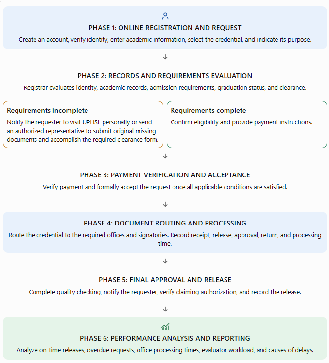

> **Image text** (image1.png):
>
> Phase 1, Online registration and request: create an account, verify identity, enter academic information, select the credential and indicate its purpose.
> → Phase 2, Records and requirements evaluation: the Registrar evaluates identity, academic records, admission requirements, graduation status and clearance.
>   - *Requirements incomplete:* notify the requester to visit UPHSL personally or send an authorized representative to submit the original missing documents and accomplish the required clearance form.
>   - *Requirements complete:* confirm eligibility and provide payment instructions.
> → Phase 3, Payment verification and acceptance: verify payment and formally accept the request once all applicable conditions are satisfied.
> → Phase 4, Document routing and processing: route the credential to the required offices and signatories; record receipt, release, approval, return and processing time.
> → Phase 5, Final approval and release: complete quality checking, notify the requester, verify claiming authorization and record the release.
> → Phase 6, Performance analysis and reporting: analyze on-time releases, overdue requests, office processing times, evaluator workload and causes of delays.

**Core principle**: The system must distinguish between the date a request is submitted and the date it is officially accepted for processing. The prescribed processing period begins only after the applicable documentary requirements and clearance have been verified, payment has been confirmed, and the Registrar’s Office has formally accepted the request.

## III. Detailed workflow for Phase 1: Online registration and credential request

### A. Customer registration and identity verification

1. **Create an account**. The customer registers using their full name, email address, contact number, and password.
2. **Verify identity**. The customer uploads a valid identification document and verifies their email address. The Registrar’s Office reviews the submitted ID to establish that the account belongs to the person requesting the academic credential.
3. **Provide academic information**. The customer indicates their student or graduate status, campus, college, program or strand, student number if available, and academic year or years of attendance at UPHSL.
4. **Select the requested credential**. The customer selects the required document, such as a Transcript of Records, Diploma, Certification, CAV, copy of grades, or transfer credentials.
5. **Indicate the purpose**. The customer states the reason for requesting the document. If applicable, they must provide the complete name of the receiving school, employer, government agency, or other institution. This information will be used in the remarks or purpose indicated in the credential, as appropriate.
6. **Review requirements, fees, and processing periods**. Before submitting the request, the customer sees the applicable documentary requirements, fee, expected processing period, required signatories, and any special conditions.
7. **Submit the online request**. The system generates a unique tracking number and sends confirmation that the request has been received for evaluation.

### B. Evaluation of academic records and documentary requirements

The Registrar’s Office evaluator reviews the submitted request against the university’s existing academic records and admission requirements.

The evaluator checks the following, as applicable:

- Authenticity and consistency of the customer’s identity.
- Student number, program or strand, campus, and academic year or years attended.
- Graduation status and eligibility for the requested credential.
- Completeness of admission requirements, particularly Form 137 or the required UPHSL copy of the previous Transcript of Records.
- PSA-authenticated birth certificate.
- Clearance status and any other applicable documentary requirements.
- Special conditions associated with the requested document.

The system should provide four possible evaluation results:

| **Evaluation result** | **Required action** |
|---|---|
| Requirements complete | Proceed to payment instructions. |
| Requirements incomplete | Notify the requester of the deficiencies and require physical compliance at the Registrar’s Office. |
| Academic record or identity requires clarification | Place the request on hold for further verification and notify the requester when necessary. |
| Request not eligible | Record the reason and notify the requester of the evaluation outcome. |

### C. Procedure when documentary requirements are incomplete

This is a critical part of the proposed system. A customer should be informed of any deficiencies before the request is accepted and the processing period begins.

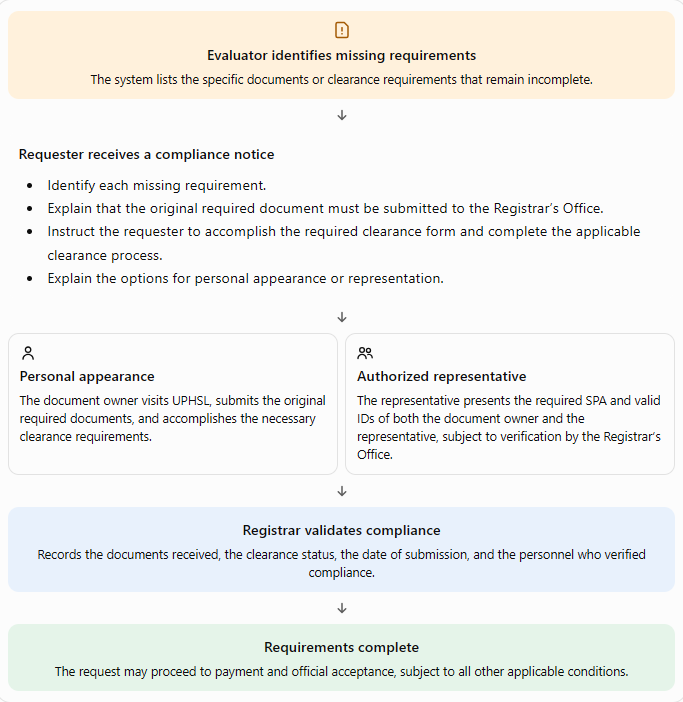

> **Image text** (image2.png):
>
> 1. **Evaluator identifies missing requirements.** The system lists the specific documents or clearance requirements that remain incomplete.
> 2. **Requester receives a compliance notice** that identifies each missing requirement; explains that the original required document must be submitted to the Registrar's Office; instructs the requester to accomplish the required clearance form and complete the clearance process; and explains the options for personal appearance or representation.
> 3. Either **personal appearance** (the document owner visits UPHSL, submits the original required documents and accomplishes the clearance requirements) or an **authorized representative** (presents the required SPA and valid IDs of both the document owner and the representative, subject to verification by the Registrar's Office).
> 4. **Registrar validates compliance.** Records the documents received, the clearance status, the date of submission and the personnel who verified compliance.
> 5. **Requirements complete.** The request may proceed to payment and official acceptance, subject to all other applicable conditions.

**System control**: Requests with incomplete requirements must remain under Pending Compliance. They must not proceed automatically to payment and document processing until the required original documents have been submitted and validated, the clearance process has been completed, and the other applicable requirements have been satisfied.

### D. Proposed notice displayed in the online portal

The following notice should appear before the customer submits a request and whenever the evaluator identifies missing requirements.

#### IMPORTANT NOTICE: INCOMPLETE REQUIREMENTS

Before submitting your online request for academic credentials, please ensure that your admission requirements and clearance are complete.

If your records indicate that you have lacking admission requirements, such as Form 137, the required UPHSL copy of your previous Transcript of Records, a PSA-authenticated birth certificate, or other applicable documents, you must first submit the **original required documents to the Registrar’s Office of the University of Perpetual Help System Laguna (UPHSL).**

You will also be required to accomplish the appropriate clearance form and complete the necessary clearance process.

You must visit the University personally or send an authorized representative on your behalf to submit the required documents and accomplish the necessary requirements. If you send a representative, the representative must present a valid Special Power of Attorney (SPA) authorizing them to act on your behalf, together with the valid IDs of both the document owner and the representative, subject to University verification.

Your online request will remain pending until the deficiencies have been resolved and verified by the Registrar’s Office. The prescribed processing period will begin only after all applicable requirements and clearance have been completed, payment has been verified, and the request has been officially accepted.

Submitting an online request does not automatically mean that your request has been accepted for processing.

## IV. Special authorization rules for requesting and claiming credentials

The system must distinguish between the document owner personally requesting or claiming a credential and an authorized representative acting on their behalf.

### A. Required documents for authorized representatives

Whenever a representative is authorized to request or claim academic credentials on behalf of the document owner, the proposed system should require the following, subject to the University’s approved authorization policy:

1. Special Power of Attorney (SPA) authorizing the representative to request and/or claim the specified academic credential.
2. Valid ID of the document owner, preferably the original ID or an acceptable copy under University policy.
3. Valid ID of the authorized representative, presented in original form for verification.
4. Any additional documents required for identity verification or the particular transaction.

The SPA should clearly identify the document owner, the representative, and the specific authority granted. The system should allow authorized Registrar personnel to record the verification result without making sensitive authorization documents visible to unauthorized users.

### B. System functions for authorization

| **Function** | **System action** |
|---|---|
| Declaration of requester | Customer indicates whether they are acting personally or through a representative. |
| Authorization document submission | Allow uploading of the SPA and IDs where permitted by University policy. |
| Verification | Authorized personnel record whether the SPA and identification documents have been verified. |
| Physical document validation | Record the actual presentation and verification of original documents when required. |
| Claiming authorization | Before release, confirm that the person collecting the credential is the owner or a duly authorized representative. |
| Release acknowledgment | Record the identity of the recipient, date and time of release, and acknowledgment of receipt. |

**Important distinction**: Online account registration must establish the identity of the document owner. A representative must not simply use the owner's account as if they were the owner. The system should record the representative's identity and authority separately.

## V. Phase 2: Payment verification and official acceptance

Once the evaluator confirms that the customer is eligible and has completed the applicable requirements and clearance, the request proceeds to payment.

1. **Generate payment instructions**. The system displays the applicable fee based on the selected credential.
2. **Submit proof of payment**. The customer uploads a screenshot or other accepted payment evidence and provides the required transaction details.
3. **Verify the payment**. Authorized personnel confirm the payment against the official payment record. An uploaded screenshot alone must not automatically mark the request as paid.
4. **Accept the request**. The evaluator or authorized personnel confirms that all applicable documentary, clearance, and payment requirements have been satisfied.
5. **Start the processing clock**. The system records the official acceptance date and time, assigns the expected release date, and activates the routing workflow.

#### Recommended request statuses

| **Status** | **Meaning** |
|---|---|
| Submitted | Online request received. |
| Under Evaluation | Academic records and requirements are being reviewed. |
| Pending Compliance | Customer must submit missing documents or complete clearance. |
| Awaiting Payment | Payment instructions have been provided. |
| Payment Verification | Proof of payment is awaiting verification. |
| Accepted for Processing | All applicable conditions have been satisfied. |
| In Progress | Credential is being prepared or processed by the required offices. |
| For Final Approval | Awaiting the remaining approval or signatory. |
| Ready for Release | Credential has completed processing and is available for release. |
| Released | Credential has been released to the owner or authorized representative. |
| Returned for Correction | A processing office has returned the document for clarification or correction. |
| Declined / Cancelled | Request has been declined or cancelled, with the reason recorded. |

The system should preserve the distinction between a customer's request being returned for missing requirements and an internal document being returned by a department for correction. These are different events and should have separate statuses and reports.

## VI. Phase 3: Document processing, routing, and signatory monitoring

This phase is the central component of the system’s internal workflow. It records the movement of every credential through the Registrar’s Office and the other departments or signatories involved in its processing.

### A. Internal workflow

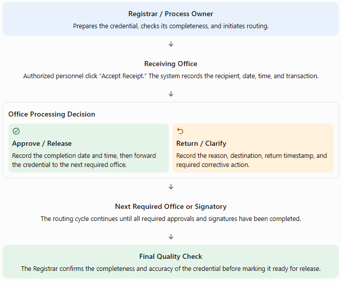

> **Image text** (image3.png):
>
> 1. **Registrar / process owner:** prepares the credential, checks its completeness and initiates routing.
> 2. **Receiving office:** authorized personnel click "Accept Receipt". The system records the recipient, date, time and transaction.
> 3. **Office processing decision:** *Approve / Release* (record the completion date and time, then forward the credential to the next required office) or *Return / Clarify* (record the reason, destination, return timestamp and required corrective action).
> 4. **Next required office or signatory:** the routing cycle continues until all required approvals and signatures have been completed.
> 5. **Final quality check:** the Registrar confirms the completeness and accuracy of the credential before marking it ready for release.

### B. Essential buttons for every participating office

| **Button** | **Purpose and recorded information** |
|---|---|
| Accept Receipt | Confirms actual receipt of the document. Records the receiving office, authorized employee, date, time, and routing transaction. |
| Approve / Release to Next Office | Records completion of the office's assigned task and the date and time the document is released for the next step. |
| Return for Correction / Clarification | Requires the reason for return, remarks, destination office, and corrective action. The system notifies the responsible personnel. |
| Forward Document | Records dispatch to the next required office, including the date, time, and destination. Receipt must still be acknowledged by the receiving office. |
| View Transaction History | Displays all receipt, release, return, resubmission, and approval events associated with the request. |

**Control requirement**: Clicking “Forward Document” must not automatically count as acknowledgment by the receiving office. The receiving office must confirm actual receipt. Similarly, releasing a document from one office does not necessarily mean the credential has received its required approval or signature.

### C. Monitoring the time spent in each office

The system should record separate timestamps for each stage:

- Date and time received by the office.
- Date and time processing commenced, if this can be captured.
- Date and time the document was approved or released.
- Date and time it was returned for correction, if applicable.
- Date and time it was resubmitted and received again.
- Reason for return, delay, or clarification.
- Employee and office responsible for each transaction.

For example, if VP Finance receives a credential on October 23 and releases it on October 27, the system calculates the elapsed working time based on the university calendar. If the document is returned to the Registrar and later sent back to VP Finance, both visits must be recorded separately.

The original transaction history must remain intact. The system should never overwrite the earlier receipt or release dates when a document is returned or reprocessed.

### D. Sample internal monitoring table

| **Office** | **Date received** | **Date released** | **Time spent** | **Status** |
|---|---|---|---|---|
| Registrar | Oct. 21 | Oct. 22 | 1 working day | Completed |
| Dean | Oct. 22 | Oct. 23 | 1 working day | Completed |
| VP Finance | Oct. 23 | Oct. 27 | 2 working days | Completed |
| Chancellor | Oct. 27 | — | In progress | Pending approval |

**Illustrative data only**. The actual system should calculate durations from timestamps rather than relying on manually entered estimates.

## VII. Phase 4: Credential types, fees, signatories, and processing periods

The system should maintain a configurable master list of credentials. Each entry should include the document name, applicable fee, required signatories, processing period, documentary requirements, special conditions, and routing sequence.

The following is initial documents that may be requested but not limited to:

| **Type of credential / request** | **Fee** | **Required signatories** | **Processing period** |
|---|---|---|---|
| Authentication | ₱50 | University Registrar | 1 working day |
| Certification, Authentication, Verification (CAV) | ₱500 | University Registrar | 2 working days |
| Certification – general | ₱230 | University Registrar, VP Finance (documentary stamp), Chancellor | 6 working days |
| Certification of Graduation | ₱230 | University Registrar, VP Finance (documentary stamp), Chancellor | 6 working days |
| Certification of Enrollment | ₱230 | University Registrar, VP Finance (documentary stamp), Chancellor | 6 working days |
| Certification of Units Earned | ₱230 | University Registrar, VP Finance (documentary stamp), Chancellor | 6 working days |
| Course Description | ₱230 | University Registrar, VP Finance (documentary stamp), Chancellor | 6 working days |
| Medium of Instruction | ₱230 | University Registrar, VP Finance (documentary stamp), Chancellor | 6 working days |
| Copy of Grades | ₱230 | University Registrar, VP Finance (documentary stamp), Chancellor | 6 working days |
| Diploma / Certificate for Non-Degree Programs | ₱800 | University Registrar, Chancellor, President | 6 working days |
| Notice of Acceptance | ₱230 | University Registrar, VP Finance (documentary stamp), Chancellor | 6 working days |
| Letter for the BI Commissioner | ₱230 | University Registrar, VP Finance (documentary stamp), Chancellor | 6 working days |
| Permit to Cross-Enroll | ₱230 | University Registrar, VP Finance (documentary stamp), Chancellor | 6 working days |
| Transcript of Records (TOR) | ₱530 | University Registrar, Dean, VP Finance (documentary stamp), Chancellor | 7 working days |
| Transfer Certificate | ₱230 | University Registrar, VP Finance (documentary stamp), Chancellor | 6 working days |
| Copy of Grades for Transfer Credentials | ₱230 | University Registrar, VP Finance (documentary stamp), Chancellor | 6 working days |
| TOR for Transfer Credentials | ₱530 | University Registrar, Dean, VP Finance (documentary stamp), Chancellor | 7 working days |
| Other or combined transfer credential requests | To be confirmed | Based on selected document/s | Based on selected document/s |

Transfer credential requests: The system must require the complete name of the receiving school. If several transfer documents are requested together, the system should apply the appropriate fee and processing rules approved by the University.

#### Automatic routing example: Transcript of Records

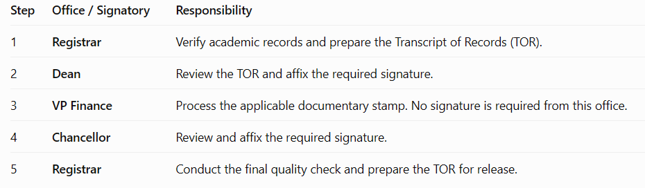

> **Image text** (image4.png):
>
> | Step | Office / Signatory | Responsibility |
> |---|---|---|
> | 1 | Registrar | Verify academic records and prepare the Transcript of Records (TOR). |
> | 2 | Dean | Review the TOR and affix the required signature. |
> | 3 | VP Finance | Process the applicable documentary stamp. No signature is required from this office. |
> | 4 | Chancellor | Review and affix the required signature. |
> | 5 | Registrar | Conduct the final quality check and prepare the TOR for release. |

Proposed routing example. The University should confirm the actual sequence, required signatories, and whether any stage needs to be combined or repeated.

For an authentication request requiring only the University Registrar, the system should generate a shorter route. Routing must be determined by the selected credential and its approved requirements.

## VIII. Phase 5: Customer tracking, notification, and release of credentials

Once the request has been officially accepted, the customer should be able to monitor the progress of the requested credential through their online account.

### A. Sample customer tracking dashboard

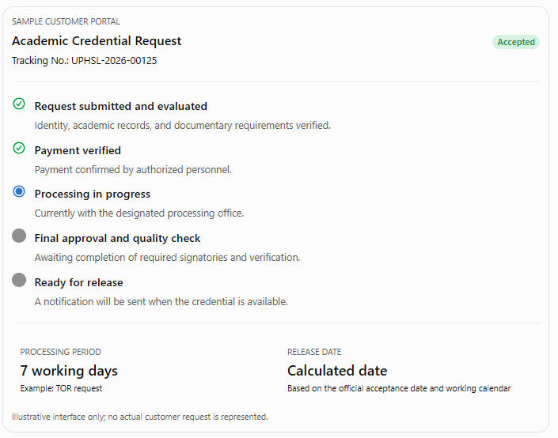

> **Image text** (image5.png):
>
> Sample customer portal: "Academic Credential Request", tracking no. UPHSL-2026-00125, badge *Accepted*. Milestones:
> ✓ Request submitted and evaluated (identity, academic records and documentary requirements verified) ·
> ✓ Payment verified (confirmed by authorized personnel) ·
> ● Processing in progress (currently with the designated processing office) ·
> ○ Final approval and quality check (awaiting required signatories and verification) ·
> ○ Ready for release (a notification will be sent when the credential is available).
> Footer: processing period "7 working days" (example: TOR request); release date "Calculated date" (based on the official acceptance date and working calendar). Illustrative interface only.

The customer dashboard should display these statuses as applicable:

- Submitted
- Under Evaluation
- Pending Compliance
- Awaiting Payment
- Payment Verification
- Accepted for Processing
- In Progress
- For Final Approval
- Ready for Release
- Released
- Returned for Customer Action
- Declined or Cancelled

The customer should receive an email or other approved notification when:

- The request is received.
- Additional requirements or clarification are needed.
- Payment instructions are available.
- Payment is verified and the request is accepted.
- The credential is ready for release.
- The request becomes overdue, where appropriate.

### B. Release and claiming procedure

Once the credential has completed all required processing and approvals:

1. The Registrar performs the final quality check.
2. The system marks the credential as Ready for Release.
3. The customer receives a notification indicating that the credential is available and providing the applicable claiming instructions.
4. The person claiming the document presents the required identification and authorization documents, if applicable.
5. The authorized releasing personnel verify the recipient's identity and authority.
6. The system records the date and time of release, the name of the recipient, and the employee who released the credential.
7. The request is marked Released, and the transaction is included in the performance reports.

Authorization requirement: If the document owner cannot personally claim the credential, the authorized representative must present the required Special Power of Attorney (SPA) and valid IDs of both the document owner and the representative, subject to the University's approved verification policy. The system must not mark the credential as released until the required verification has been completed.

## IX. Phase 6: Performance analysis and management reporting

The system should provide a performance dashboard that enables the Registrar and authorized administrators to evaluate the efficiency of credential processing and the quality of service delivery.

### A. Recommended dashboard indicators

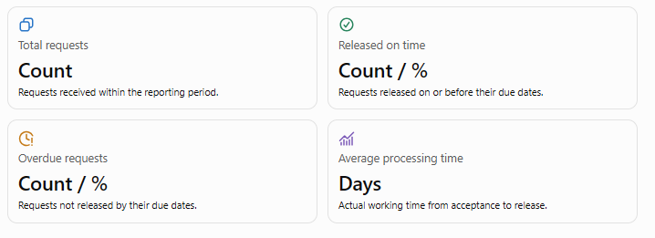

> **Image text** (image6.png):
>
> Four tiles: **Total requests** (count of requests received within the reporting period) · **Released on time** (count / %, released on or before their due dates) · **Overdue requests** (count / %, not released by their due dates) · **Average processing time** (days, actual working time from acceptance to release).

### B. Recommended reports

| **Report** | **Information to be generated** | **Purpose** |
|---|---|---|
| Daily monitoring report | Requests received, accepted, pending, completed, and overdue | Monitor daily operations |
| Weekly performance report | On-time releases, overdue cases, average processing time, and pending requests | Identify recurring issues |
| Monthly performance report | Request volume, credential types, on-time percentages, and trends | Support management review |
| Evaluator performance report | Number of requests evaluated, pending evaluations, turnaround time, and workload | Monitor workload and evaluation efficiency |
| Department performance report | Documents received and released, average processing time, returns, and pending items | Identify office-level bottlenecks |
| Signatory monitoring report | Documents pending approval and duration of pending status | Support timely follow-up |
| Credential tracking report | Complete routing history, timestamps, and return records | Establish traceability and accountability |
| Delay analysis report | Overdue requests, stage where delays occurred, duration, and reasons | Determine corrective action |
| Customer compliance report | Requests awaiting missing requirements, clearance, or payment | Improve customer communication |
| Release report | Credentials ready for release, claimed, and unclaimed | Monitor final service delivery |

Reports should be filterable by date range, credential type, evaluator, department, campus, and overall office performance, with export options for authorized users.

### C. Computation of performance indicators

#### 1. On-time release percentage

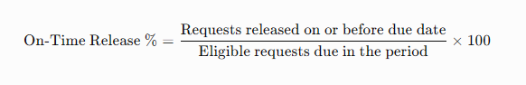

> **Image text** (image7.png):
>
> On-Time Release % = (Requests released on or before due date ÷ Eligible requests due in the period) × 100

#### 2. Overdue release percentage

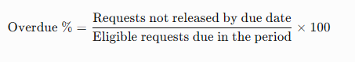

> **Image text** (image8.png):
>
> Overdue % = (Requests not released by due date ÷ Eligible requests due in the period) × 100

#### 3. Average processing time

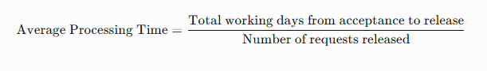

> **Image text** (image9.png):
>
> Average Processing Time = Total working days from acceptance to release ÷ Number of requests released

#### 4. Average time spent in each office

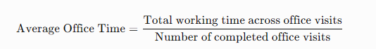

> **Image text** (image10.png):
>
> Average Office Time = Total working time across office visits ÷ Number of completed office visits

For office-level analysis, every visit should be recorded separately. If a credential returns to the same office for correction, the system should retain both visits and their respective durations.

**Reporting rule**: The on-time and overdue percentages should use requests whose due dates fall within the reporting period as the denominator. Requests still within their processing period should not be counted as overdue. Open requests past their due dates should be separately reported as overdue workload.

### D. Delay and bottleneck analysis

The system should identify not only where a document is pending but also the recorded reason for the delay.

Suggested delay categories include:

- **Registrar / evaluation**: Academic record verification, incomplete information, or document preparation.
- **Customer compliance**: Missing admission requirements, clearance, affidavit of loss, or other required documents.
- **Payment verification**: Payment has not yet been confirmed or requires clarification.
- **Academic department / Dean**: Pending review, correction, or approval.
- **VP Finance**: Delayed Documentary stamp processing or related clarification.
- **Dean/ Chancellor / President**: Pending signature
- **Document correction**: Errors in the document, academic details, or remarks.
- **System or technical issue**: System downtime or unavailable electronic records.
- **Other**: A specific explanation entered by the responsible personnel.

For every delayed request, the report should identify the tracking number, credential type, acceptance date, expected release date, current office, duration at each office, return history, recorded cause, responsible next action, and corrective action taken.

The system must distinguish the office currently holding the document from the underlying cause of the delay. These may not be the same.

### E. Sample bottleneck report

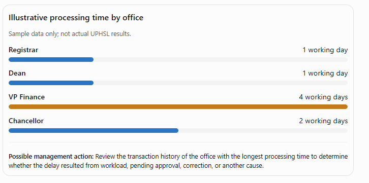

> **Image text** (image11.png):
>
> Illustrative processing time by office (sample data only, not actual UPHSL results): Registrar 1 working day · Dean 1 working day · **VP Finance 4 working days** (highlighted) · Chancellor 2 working days.
> Possible management action: review the transaction history of the office with the longest processing time to determine whether the delay resulted from workload, pending approval, correction or another cause.

## X. Additional system controls and security requirements

The following controls should be included in the system specifications.

| **Control** | **Required functionality** |
|---|---|
| Automatic due-date computation | Calculates the expected release date using the processing period and approved university working calendar. |
| Complete audit trail | Records every receipt, release, return, resubmission, and approval with timestamps and authorized user details. |
| Configurable routing | Allows authorized administrators to update signatories, routing sequences, fees, and processing periods. |
| Return and reprocessing control | Preserves the original transaction history and records every subsequent action. |
| Automatic reminders | Alerts offices when documents are approaching their due dates or have become overdue. |
| Role-based access | Restricts access to customer records, IDs, academic documents, internal remarks, and reports according to assigned roles. |
| Secure document storage | Protects uploaded IDs, academic records, payment evidence, and authorization documents from unauthorized access. |
| Authorization verification | Records verification of the SPA and IDs for authorized representatives. |
| Working calendar management | Accounts for weekends, holidays, and approved non-working days when calculating processing periods. |
| Deadline and delay rules | Preserves the original due date and records any formally approved pause separately. |

For fairness and accurate reporting, the system should not automatically exclude delays simply because a document was returned. The original due date should remain visible, while any approved adjustment or pause is recorded separately in accordance with the University's approved service policy.

## XI. Proposed functional modules

The proposed system may be divided into the following modules for development and testing.

| **No.** | **Module** | **Main functions** |
|---|---|---|
| 1 | User Registration and Identity Verification | Account creation, valid ID upload, email verification, and identity review |
| 2 | Academic Information and Records Evaluation | Student status, campus, program, academic years, record verification, and eligibility |
| 3 | Credential Request Management | Document selection, purpose, receiving school, fees, requirements, and tracking number |
| 4 | Documentary Compliance and Clearance | Deficiency notices, original document submission, clearance form monitoring, and compliance verification |
| 5 | Representative Authorization | SPA and ID verification, authorization records, and release eligibility |
| 6 | Payment Verification | Payment instructions, proof upload, verification, and payment status |
| 7 | Credential Processing and Routing | Routing based on document type, required signatories, and processing sequence |
| 8 | Document Receipt, Release, and Return | Acknowledgment of receipt, forwarding, approval, returns, and remarks |
| 9 | Customer Tracking and Notifications | Progress tracker, due date, compliance alerts, and release notification |
| 10 | Performance Monitoring and Analytics | Processing time, on-time releases, overdue requests, and bottleneck analysis |
| 11 | Reports and Dashboard | Daily, weekly, monthly, evaluator, department, and credential-level reports |
| 12 | Administration and Audit Trail | User roles, fees, routing configuration, working calendar, system logs, and access control |

## XII. Proposed end-to-end process flow for the system developer

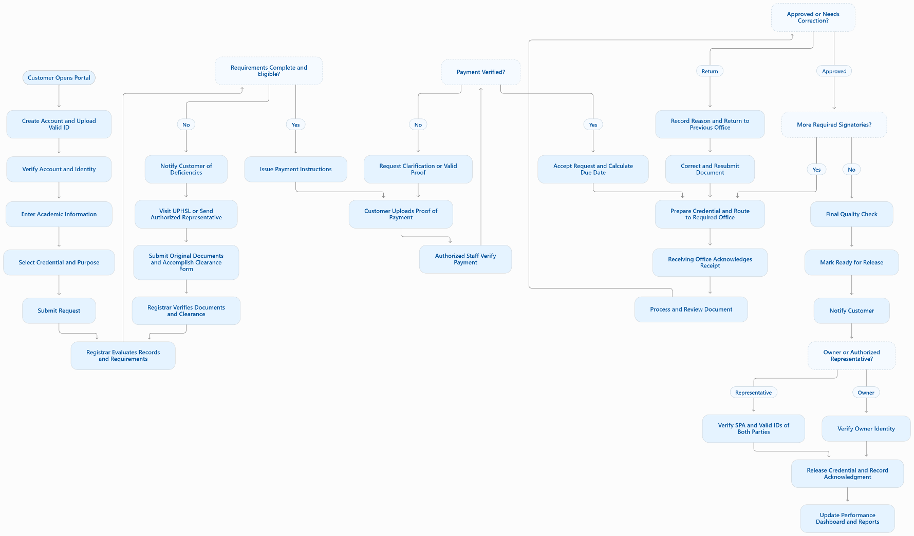

> **Image text** (image12.png):
>
> 1. Customer opens portal → create account and upload valid ID → verify account and identity → enter academic information → select credential and purpose → submit request.
> 2. Registrar evaluates records and requirements → **Requirements complete and eligible?**
>    - *No:* notify customer of deficiencies → visit UPHSL or send authorized representative → submit original documents and accomplish clearance form → Registrar verifies documents and clearance → back to evaluation.
>    - *Yes:* issue payment instructions.
> 3. Customer uploads proof of payment → authorized staff verify payment → **Payment verified?**
>    - *No:* request clarification or valid proof → customer uploads proof again.
>    - *Yes:* accept request and calculate due date.
> 4. Prepare credential and route to required office → receiving office acknowledges receipt → process and review document → **Approved or needs correction?**
>    - *Return:* record reason and return to previous office → correct and resubmit document → route again.
>    - *Approved:* **More required signatories?** *Yes:* route to the next office. *No:* final quality check.
> 5. Final quality check → mark ready for release → notify customer → **Owner or authorized representative?** *Representative:* verify SPA and valid IDs of both parties. *Owner:* verify owner identity.
> 6. Release credential and record acknowledgment → update performance dashboard and reports.

The following flowchart consolidates the major decision points into a single process.

## XIII. Suggested Performance Measures for the Proposed System

The proposed system should include a monitoring and reporting feature to help the Registrar’s Office assess its efficiency and quality of service. The following indicators are recommended for evaluating the system’s performance:

1. **On-time release rate** – Percentage of credential requests released within the prescribed processing period.
2. **Average processing time** – Average number of working days required to process each type of credential.
3. **Processing time per office and signatory** – Time spent by each office or signatory in reviewing, processing, or signing a document.
4. **Returned documents** – Number and percentage of documents returned for corrections or additional information.
5. **Overdue requests** – Number of requests that exceed the prescribed processing period, including the recorded reasons for delay.
6. **Initial evaluation time** – Time between online submission and the Registrar’s initial evaluation of the request.
7. **Pending requests** – Number of requests awaiting compliance with documentary requirements, clearance, or payment verification.
8. **Document tracking accuracy** – Completeness and accuracy of records showing when documents are received, processed, forwarded, returned, and approved.
9. **Customer notification timeliness** – Timeliness of notifications regarding request status, deficiencies, payment verification, and document availability.
10. **Request volume and release performance** – Number of requests received, processed, and released within a selected reporting period, such as daily, weekly, or monthly.

The system should generate reports that will help identify processing delays, pending transactions, and offices that may require workflow improvements. Where baseline data are available, the performance of the Registrar’s Office before and after system implementation may be compared to determine whether service delivery has improved.

In evaluating processing performance, the system should distinguish delays caused by internal offices from those caused by pending customer requirements, payment verification, or other factors beyond the processing office’s control. This will help ensure that performance reports are accurate and fair.

## XIV. Expected outcome of the proposed system

The proposed system is expected to provide UPHSL’s Registrar’s Office with an integrated platform that enables customers to submit requests online, understand their documentary obligations, monitor progress, and receive timely release notifications.

Internally, it will establish an electronic record of every document's movement, provide visibility into processing time per office, preserve the history of returns and corrections, and generate performance reports that support accountability and continuous improvement.

Most importantly, the system will enable the Registrar to determine not only whether a credential was released on time, but also where delays occurred, how long they lasted, why they happened, and what corrective action may be necessary.

Before development, the Registrar’s Office should validate the official documentary requirements, clearance procedures, authorization rules, fees, signatory sequences, and processing periods. These approved rules should then be encoded into the system so that the workflow reflects actual UPHSL policies and practices.
